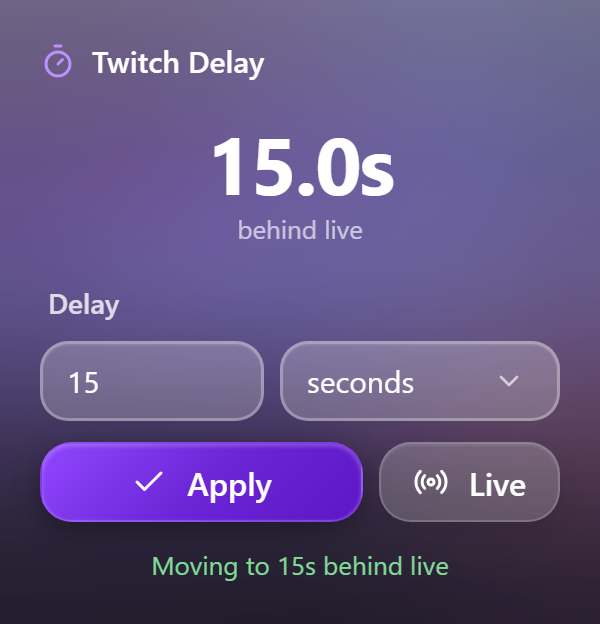

# Twitch Delay

A Chrome extension that holds a Twitch live stream a set amount of time behind live, from half a second up to an hour. Add the gap between you and your friends to your own stream, and you see the same moment together.



## Features

- **Any delay** in seconds, minutes or hours.
- **Live readout** of how far behind live you are, with a countdown while the delay builds up.
- **Smooth adjusting:** a longer delay freezes the picture for the difference, a shorter one plays faster until it catches up.
- **Twitch's volume and mute buttons** control the delayed audio.
- **Remembered** across reloads, channel switches and tabs.

## Install

1. Get the code:
   ```powershell
   git clone https://github.com/alia720/twitch-delay.git
   ```
2. Open `chrome://extensions` and turn on **Developer mode**.
3. Click **Load unpacked** and pick the `twitch-delay` folder.
4. Refresh any open Twitch tabs.

## Use

1. Open a live stream on twitch.tv.
2. Click the Twitch Delay icon, enter a delay, and press **Apply**. The stream plays that far behind live once the countdown ends.
3. Press **Live** to go back to normal.

## How it works

The extension records Twitch's video as it plays and shows that recording, a set time later, in its own video layered over Twitch's player.

![Architecture: the popup sends the delay to content/commands.js, which saves it to chrome.storage, read by content/settings.js in every Twitch tab. Settings drives the recorder, which captures Twitch's muted video into 1-second chunks held in memory. After the delay, Media Source Extensions play the chunks in an overlay video layered on Twitch's player. A once-a-second check starts and stops recording, a half-second timer steers playback, and content/audio.js routes Twitch's volume and mute to the overlay.](docs/architecture.png)

## Project structure

| Path | Job |
|---|---|
| [`manifest.json`](manifest.json) | Extension setup (Manifest V3) |
| [`popup/`](popup) | The popup UI, with GlassKit and Lucide in `vendor/` |
| [`content/settings.js`](content/settings.js) | Loads and saves the delay |
| [`content/commands.js`](content/commands.js) | Handles the popup's messages |
| [`content/recorder.js`](content/recorder.js) | Recording, overlay and timing |
| [`content/measure.js`](content/measure.js) | Works out the readout |
| [`content/stream.js`](content/stream.js) | Finds Twitch's live `<video>` |
| [`content/format.js`](content/format.js) | Formats times |
| [`content/audio.js`](content/audio.js) | Points Twitch's volume and mute at the delayed audio |

## Limits

- About 45 MB of memory per minute of delay.
- Re-encoding uses some CPU and softens the picture slightly.
- You wait out the delay once before playback starts.
- Twitch's pause button isn't supported while a delay is on.

## Third-party code

- [GlassKit](https://github.com/JUNGHERZ/GlassKit) 1.40.0, MIT License
- [Lucide](https://lucide.dev) 0.460.0, ISC License
